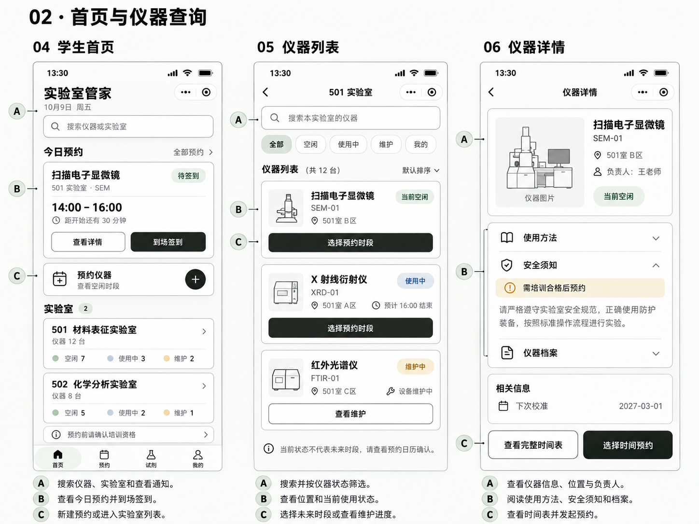

# 实验室管家 · 微信小程序与 AI 交接

按「教室配置＋功能模块」拆分的实验室仪器预约项目，附完整设计图与开发交接文档。

## 给接手开发的人或 AI

先读 [交接入口](AI交接目录/README.md)、[NEXT 当前进度](AI交接目录/NEXT.md) 和 [拆分规则](AI交接目录/AGENTS.md)。**禁止把全部功能堆进一个文件，也不要为每个教室复制一套业务代码。**

- 501、502 教室各自配置，共用业务规则。
- 预约、权限、仪器、试剂、样品、日志分别拆分。
- 12 组设计图涵盖 36 个界面；附 A/B/C 功能说明。
- 已开始实现 14 个原生小程序页面，15 项本地自动化测试通过。
- 当前是单设备本地演示，正式账号、后端同步和微信真机验证尚未接入。

## 下载

[下载完整交接包和分模块图片包](https://github.com/jiuyi777/lab-manager-miniprogram/releases)

也可以点击 GitHub 的 **Code → Download ZIP** 获取全部源码、文档和图片。

## 内容入口

| 内容 | 位置 |
| --- | --- |
| 接续任务与已知限制 | [NEXT.md](AI交接目录/NEXT.md) |
| 架构与禁止堆叠规则 | [架构与拆分](AI交接目录/需求与规范/架构与拆分.md) |
| 各功能说明与设计图 | [功能模块](AI交接目录/功能模块) |
| 教室配置说明 | [教室配置](AI交接目录/教室配置) |
| 微信小程序源码 | [软件](AI交接目录/软件) |
| 36 页实现状态 | [界面实现矩阵](AI交接目录/需求与规范/界面实现矩阵.md) |

## 本地检查

需要 Node.js，无第三方依赖，无需安装依赖包。

```sh
cd AI交接目录/软件
npm test
npm run check
```

微信开发者工具导入 `AI交接目录/软件`。详细操作见 [运行与验证](AI交接目录/需求与规范/运行与验证.md)。本地演示账号切换仅用于流程演示，不是真实身份认证。

## 视觉示例

白底、黑绿按钮、浅绿与奶黄点缀，卡片细描边和轻微新拟物层次。



图中数据为演示数据；图片已生成不代表所有页面已开发完成。完整交接以 NEXT.md 和实现矩阵为准。
